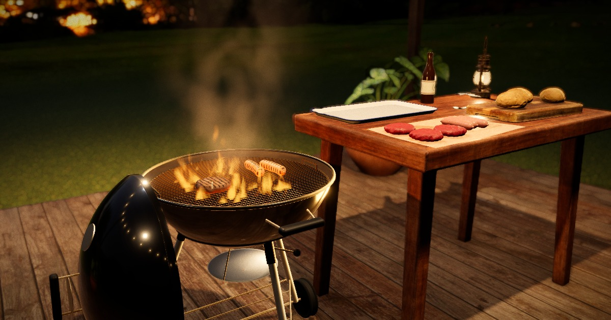

# fable-5.2-tests

Browser experiments. One folder per test, and every test is a static page with no build step.

**Live:** https://thequantling.github.io/fable-5.2-tests/

| # | Test | What it is | Open |
| --- | --- | --- | --- |
| 01 | [Midnight BBQ](bbq/) | A charcoal kettle on a garden deck at night. Orbit it, cook on it. | [thequantling.github.io/fable-5.2-tests/bbq/](https://thequantling.github.io/fable-5.2-tests/bbq/) |

[](https://thequantling.github.io/fable-5.2-tests/bbq/)

## 01 · Midnight BBQ

A real-time 3D barbecue built with [three.js](https://threejs.org) on WebGL 2. It runs with mouse and
keyboard on a desktop and with touch on a phone or tablet.

### What you can do

| Action | Mouse | Touch |
| --- | --- | --- |
| Look around | Drag | Drag with one finger |
| Zoom | Scroll | Pinch |
| Pan | Right-drag | Drag with two fingers |
| Put food on the grill | Drag a burger or sausage onto the grate | Same |
| Flip a burger, roll a sausage | Click it | Tap it |
| Serve | Drag it onto the enamel tray | Same |
| Stoke the fire | Click the coals | Tap the coals |

Keys: `V` next camera view, `M` sound on or off, `H` help, `U` hide the interface, `Esc` close help.

The coals are banked to the left, so that side of the grate cooks faster. Food left on too long burns.

### How it is made

- **Fire, smoke and heat haze** are ray-marched through the depth buffer as a single post-processing
  effect, so flames pass correctly behind the grate bars and in front of the bowl. The fire also
  lights the scene with a flickering light, and sparks fly when you stoke it or fat flares up.
- **Food** is hand-formed geometry with a material that goes from raw to seared to burnt. Doneness is
  tracked per face for burgers and per quarter-turn for sausages. Grill marks are computed from
  where the bars were when the food lay on them, so they stay crisp in close-up.
- **Charcoal** is about 130 fractured lumps that glow through their cracks and undersides.
- **Camera pipeline:** HDR render, ambient occlusion, volumetric fire, depth of field, bloom, ACES
  filmic tone mapping, colour grade, vignette and film grain.
- **Lighting** comes from a night-sky HDRI, festoon string lights over the deck, a lantern and the fire.
- **Sound** is synthesised in the browser from noise and sine waves: sizzle, crackle and crickets.
  Nothing plays until your first click, tap or key press.
- **Quality tiers.** The page picks `high` on a desktop GPU, `medium` or `low` on a phone, and `low`
  when the browser renders in software. Each tier changes resolution, anti-aliasing, ambient
  occlusion, depth of field, and the number of ray-march steps.

### URL parameters

| Parameter | Effect |
| --- | --- |
| `?q=high`, `?q=medium`, `?q=low` | Force a quality tier |
| `?view=hero`, `grate`, `macro`, `low` or `wide` | Start from that camera |
| `?start=raw` | Start with nothing on the grill |
| `?ui=0` | Hide the interface, for screenshots |

## Run it locally

The pages use ES modules, so they need to be served over HTTP rather than opened from disk. Any
static file server works:

```sh
git clone https://github.com/thequantling/fable-5.2-tests.git
cd fable-5.2-tests
python3 -m http.server 8000
```

Then open `http://localhost:8000/`.

## Layout

```
index.html          landing page
bbq/
  index.html        test 01
  src/              18 ES modules, about 2,500 lines
  assets/           HDRI, deck textures, scanned models
  vendor/           three.js, postprocessing, n8ao
```

## Credits

Scanned assets are from [Poly Haven](https://polyhaven.com), all released under CC0:

| Asset | Used for | Author |
| --- | --- | --- |
| Moonlit Golf (HDRI) | Sky, backdrop and ambient light | Greg Zaal |
| Weathered Brown Planks (texture) | Deck timber | Dimitrios Savva, Rico Cilliers |
| Wooden Table 02 | Side table | Serhii Khromov |
| Wooden Cutting Board | Board under the buns | Kuutti Siitonen |
| Hamburger Buns | Buns | Alexander Shulha |
| Lantern 01 | Lantern | Rajil Jose Macatangay |
| Potted Plant 02 | Plants | Rico Cilliers |

Everything else is generated in code: the kettle, grates, charcoal, burgers, sausages, tray, butcher
paper, bottle, tongs, deck structure, lawn, string lights, fire, smoke, sparks and sound.

Vendored libraries, with their licence files, are in `bbq/vendor/`:

| Library | Version | Licence |
| --- | --- | --- |
| [three.js](https://github.com/mrdoob/three.js) | r187 | MIT |
| [postprocessing](https://github.com/pmndrs/postprocessing) | 6.39.6 | Zlib |
| [n8ao](https://github.com/N8python/n8ao) | 2.0.1 | CC0 1.0 |

The copy of n8ao carries one local patch, marked with a comment in `N8AO.js`. Its
multiple-render-target shim overrode `texture` to return an array, which crashes half-resolution
ambient occlusion on current three.js releases, so that override is removed.
